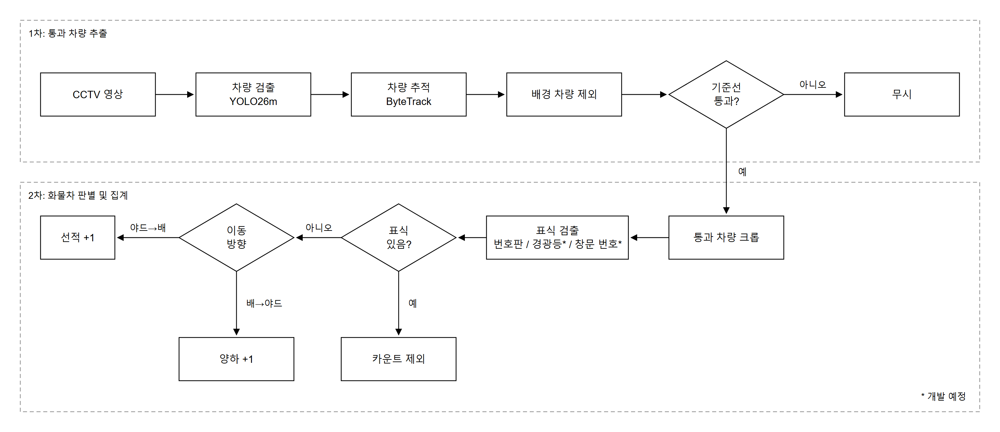

# COUNT — 선적·하역 차량 실시간 카운트

자동차 운반선(RoRo) 램프를 찍는 고정 CCTV(RGB, 2560×1440, 15~20 fps)로
**통과선을 넘는 화물차 대수를 선적(야드→배)·하역(배→야드)별로 실시간으로 센다.**
현장을 오가는 세이프티카·작업차는 화물이 아니므로 **제외**해야 한다.

([← 저장소 개요](../README.md))



---

## 문제의 어려움

| 상황 | 왜 어려운가 |
|---|---|
| 화물차가 전부 비슷함 | 같은 차종·같은 색 신차가 줄지어 통과 → 외형 재식별(re-ID)로 중복 제거 불가 |
| 세이프티카도 흰 쏘나타 | 흰 화물 세단과 외형이 거의 같음 (외형 임베딩 분류는 흰/은색 화물차 오판 17/169 로 기각) |
| 표식이 작고 다양함 | 경광등(빨강·파랑·주황·흰색), 창문 번호(앞유리·옆창·뒷유리), 번호판 — 크기 수십 px, 반사·훼손 |
| 배경에도 비슷한 것 | 과속 경고등·볼라드 불빛(→경광등 오인), 문손잡이·스티커(→번호 오인) |
| 선 위 가림·ID 스위치 | 양방향 동시 통과 시 트랙이 끊기거나 섞임 |
| 실시간 | 선을 넘은 뒤 1초 안에 판정해야 함 |

핵심 단서: **화물차(신차)에는 번호판이 없다.** 세이프티카는 경광등·창문 번호(1~7)·번호판이 있고,
번호판 달린 트럭은 작업차. → "표식이 여러 프레임에서 반복되면 제외" 라는 규칙으로 2분류(화물/제외).

---

## 파이프라인

```
RTSP 프레임 ─► [1단계] yolo26m(COCO) + ByteTrack ─► 트랙 체인(ID 스위치·가림 연결) ─► 통과선 교차 → 방향(선적/하역)
                                   │
                                   └─► 차량 크롭(접근 중 최대 8장) ─► [2단계] 표식 탐지 yolo26s (번호판·경광등·창문번호)
                                                                     ─► 표식 이동 규칙 ─► "2장 이상 표식 → 제외" ─► 화물/제외
```

- **1단계 차량 탐지**는 학습하지 않은 COCO 모델 그대로 (imgsz 640; 1280 은 근접 대형차 conf 급락으로 기각).
- **트랙 체인** (`count_events.py`): ID 스위치로 끊긴 조각 연결 + **가림 연결**(선 양쪽, 1초 이내, 같은 방향 진행 —
  선 위에서 가려져 두 이벤트로 잡히던 사례를 사용자 검수에서 발견해 추가).
- **표식 이동 규칙**: 표식은 차와 함께 움직여야 한다. 차가 실제로 움직였는데(박스 양 끝이 같은 방향으로 이동)
  화면 좌표가 고정이고 차량 기준 같은 자리에 짝이 없으면 고정 구조물로 보고 버린다. 과속 경고등·볼라드 불빛 오탐 제거.
- **실시간 판정** (`realtime_sim.py`): 파일을 RTSP 처럼 pts 시각에 맞춰 흘려보내고(1칸 버퍼, 밀리면 드롭),
  선을 넘는 프레임에서 바로 카운트·판정(접근 중 모은 크롭 사용). 선 넘음→판정 지연 p50 0.2 s, max 0.9 s.
  스트림 재전송(같은 프레임 반복) 감지 포함 — 단, 같은 차종 행렬과 구분되도록 픽셀 수준 일치만 잡음.

---

## 데이터·라벨링 (human-in-the-loop)

라벨링은 전부 **Claude 가 초안 → 사용자가 웹 검수 페이지에서 확인·수정** 순서로 진행했다
(검수 페이지는 `count/web/`, 결과는 페이지 DB 에 저장 후 스크립트로 반영).

1. **차량 이벤트 검수** — 1,297 건(260731·0818 s1·s2)을 클립과 함께 화물/세이프티/작업으로 분류.
   자동 분류가 전부 정답이었고, 미탐 후보에서 가림 연결 규칙과 누락 차량을 찾아냄.
2. **표식 박스 1차 검수** — 자동 초안(YOLOE 텍스트·시각 프롬프트)을 크롭 312장에서 정확/틀림/누락으로 판정 →
   세이프티 크롭 75%에 누락. 흰 경광등·측면 창문 숫자가 원인임을 확인.
3. **표식 박스 수정** — 개선 초안을 240장에 미리 그려두고 사용자가 그리기·지우기·크기 조정으로 정답 작성.

| 표식 모델 | 학습 라벨 | 비고 |
|---|---|---|
| r1 | 자동 초안 (시각 프롬프트 참조 1장) | 창문 번호 재현율 낮음 |
| r2 | 개선 자동 초안 (참조 4장: 흰 경광등·측면 숫자 추가, 이동 규칙) | |
| r3 | 사용자 정답 240장 + 정답으로 기준값을 튜닝한 자동 라벨 | 최종 (`count/models/marks_r3.pt`) |

정답에서 잰 표식 성능(학습에 안 쓴 영상 0818 s1, 크롭 45장, IoU 0.5):

| 모델 | 번호판 P / R | 경광등 P / R | 창문 번호 P / R |
|---|---|---|---|
| r1 | 0.95 / 0.64 | 0.86 / 0.76 | 0.45 / 0.26 |
| r2 | 0.95 / 0.75 | 0.91 / 0.87 | 0.45 / 0.72 |
| **r3** | 0.95 / 0.71 | 0.94 / 0.85 | 0.47 / 0.83 |

---

## 종합 평가 (r3, 실시간 시뮬레이터)

선을 넘는 순간 판정, 프레임 드롭 없는 모드(정확도용). 정답은 사용자 육안 검수.

| 영상 | 표식 학습 사용 | 정답 대비 이벤트 | 화물/제외 판정 오류 |
|---|---|---|---|
| 260701 s1 | 미사용 | 32/32 | 1 (작업 트럭 → 화물: 접근 중 크롭에 번호판 안 보임) |
| 260701 s3 | 미사용 | 141/141 | 0 |
| 260701 s4 (검수 구간) | 미사용 | 33/33 | 1 (화물 → 제외: 트렁크 스티커를 창문 번호로) |
| 260818 s1 | 검증용 | 260/262 (세이프티 2대 미탐) | 0 |
| **260818 s3 (최종 평가 전용)** | 미사용 | **통과 순서 103대 중 101대 일치** | 2 (밀집 구간 방향 오판 1, 세이프티와 엇갈린 화물 1) |

- 최종 평가 영상 집계: 선적 화물 34 (정답 33), 하역 화물 34 (정답 36), 제외 35 (정답 34).
- 실시간 성능 (RTX 2080 SUPER): 15 fps 스트림을 14.8 fps 로 처리(드롭 1.4%), **선 통과 → 판정 p50 0.3 s, 최대 0.8 s**,
  프레임당 탐지·추적 p50 39 ms, GPU 메모리 약 335 MB.
- 기각한 규칙: "번호판 1장만 있어도 제외" — 미사용 영상에서 되살린 작업차 0, 오히려 화물 오제외 1 → 채택 안 함.

남은 약점: 반대 방향으로 엇갈리는 차량 사이의 트랙 섞임, 번호판이 뒤에만 있는 작업 트럭(선 통과 전에는 안 보임),
창문 번호 오탐(정밀도 0.5 안팎).

### 표식 모델별 비교 (미사용 영상 4개, 차량 309대)

| 모델 | 학습 데이터 | 정확 |
|---|---|---|
| r1 | 자동 초안(참조 1장) | 299 (96.8%) |
| r2 | 개선 자동 초안(참조 4장 · 이동 규칙) | 304 (98.4%) |
| r3 | 사람이 박스 수정한 정답 + 자동 라벨 | **305 (98.7%)** |

`model_compare.py` 로 생성. 처리 시간은 세 모델 동일 (같은 구조).

## 추적 보정과 TensorRT (2026-11-25)

**칼만 예측 프레임 간격 보정** (`kalman_gap.py`). ByteTrack 은 update 1회를 1프레임으로 가정해,
실시간 처리에서 프레임을 k장 건너뛰면 예측이 실제 위치보다 뒤처지고 lost 트랙 보관 시간도 실제보다 길어진다.
건너뛴 만큼 칼만 예측을 1+k 번 돌리고 `frame_id` 를 k 올린다. 같은 시드로 프레임을 버리는 재현 모드(`realtime_sim.py --sim-drop`)로 비교:

| 영상 · 버린 프레임 | 보정 없음 | 보정 | 기준 (안 버림) |
|---|---|---|---|
| 260818 s1 · 30% | 미탐 19, 판정 오류 1 | **미탐 2, 판정 오류 0** | 미탐 2, 판정 오류 0 |
| 260701 s3 · 50% | 미탐 5, 판정 오류 1 | **미탐 2, 판정 오류 1** | 미탐 0 |
| 260701 s3 · 30% | 미탐 1, 판정 오류 2 | **미탐 1, 판정 오류 1** | 미탐 0 |

**트랙 조각 규칙.** 지나가던 차의 id 가 램프 구조물 벽면 오검출(약 1100x250 박스)로 넘어가 1대가 더 세지는 경우가 있어,
같은 id 의 박스 종횡비가 1.8배 넘게 바뀌면 조각을 나누고(정상 트랙 약 9.8만 쌍에서 최대 1.59배), 멈춰 있는 조각에는 잇지 않는다.
프레임을 안 버리는 회귀 평가 4개 영상에서 결과 변화 없음.

**TensorRT (FP16).** 차량 탐지 프레임당 33~40 → 22~30 ms, 표식 판정 차량당 100~200 → 90~115 ms, GPU 메모리 330 → 204 MB.
이벤트는 4개 영상 모두 동일. 판정은 260701 s3 의 작업 트럭 1대만 갈렸다 (창문 번호 오탐 2장에 기대던 경계 사례, 고른 크롭이 1프레임 달라짐).

**기각: 선 통과 후 재판정.** 선을 넘은 뒤 크롭으로 다시 판정해 화물 → 제외로 바꾸는 방식을 기록 전용으로 측정
(`--post-check`): 고친 대수 0, 새 오류 1, 차량당 GPU 70~90 ms 추가 → 채택 안 함.

**테스트** (GPU 불필요): `test_kalman_gap.py [--core]`, `test_tracking_rules.py`, `test_deploy_core.py [--gpu]`.
`--core` 는 배포 패키지에 복사된 구현을 같은 입력으로 검사한다.

## 현장 배포 패키지 (`count/deploy/`)

저장소에 의존하지 않는 실행 패키지. RTSP 입력 → 실시간 카운트 → 로컬 DB(SQLite) + 차량별 통과 스크린샷 · 전후 1.5초 클립.
Ubuntu 22.04/24.04 (`install.sh`, 자동 실행 등록) 와 Windows (`windows/*.bat`) 지원. 시작할 때 현재 화각에서 기준선을 긋는다.
TensorRT 엔진은 현장 GPU 에서 처음 실행 때 자동 생성, 실패하면 PyTorch 로 실행. 자세한 내용은 [deploy/README.md](deploy/README.md).
모델 가중치는 저장소에 넣지 않고 배포 zip 을 만들 때 `count/models/marks_r3.pt` 와 사전학습 `yolo26m.pt` 를 `deploy/models/` 에 넣는다.

---

## 데이터 분할 원칙

| 영상 | 용도 |
|---|---|
| 260701 s1~s4 (20 fps) | 카운트 로직 초기 설계. 표식 학습 미사용 → 다른 날짜 검증 |
| 260731, 260818 s2 | 표식 모델 학습 |
| 260818 s1 | 표식 모델 검증 + 실시간 시뮬레이터 튜닝 |
| 260818 s3 | **최종 평가 전용 (학습·튜닝·검토 금지)**, 정답은 사용자가 통과 순서로 직접 집계 |

---

## 폴더 구조

```
count/
├── scripts/   # 파이프라인 (아래 표)
├── web/       # 검수 웹페이지 (차량 이벤트·표식 판정·표식 박스 수정)
├── models/    # 표식 탐지 배포 모델
├── deploy/    # 현장 실행 패키지 (RTSP · DB · 기준선 설정 · Ubuntu/Windows)
└── docs/
```

데이터는 `data/COUNT/`(영상·크롭·정답), 산출물은 `runs/count/` — 둘 다 gitignore.

## 스크립트 (`count/scripts/`)

| 단계 | 스크립트 |
|---|---|
| 트랙 추출·이벤트 | `extract_tracks.py`, `count_events.py`, `classify_events.py`, `run_pipeline.py`, `eval_count.py` |
| 차량 검수 | `build_review_web.py`, `build_review_clips.py`, `add_review_items.py`, `apply_review.py` |
| 표식 크롭·초안 | `extract_mark_crops.py`, `draft_marks.py`, `draft_marks2.py`, `filter_marks.py`, `fill_marks.py`, `merge_marks.py` |
| 표식 검수·정답 | `build_marks_review.py`, `build_marks_edit.py`, `eval_marks.py`, `make_r3_labels.py` |
| 학습 데이터 | `make_marks_dataset.py` |
| 실시간·평가 | `realtime_sim.py`, `eval_rt.py`, `replay_rule.py`, `render_demo.py`, `model_compare.py` |
| 추적 보정·테스트 | `kalman_gap.py`, `test_kalman_gap.py`, `test_tracking_rules.py`, `test_deploy_core.py` |
| 실험(기각) | `exp_plate_zeroshot.py`, `exp_embed_cls.py` |
